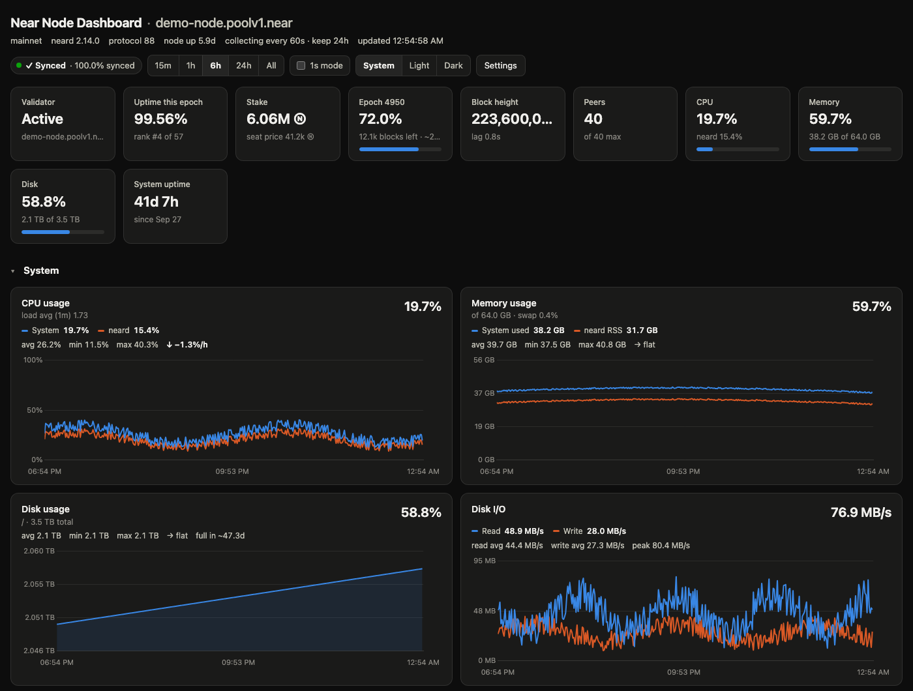
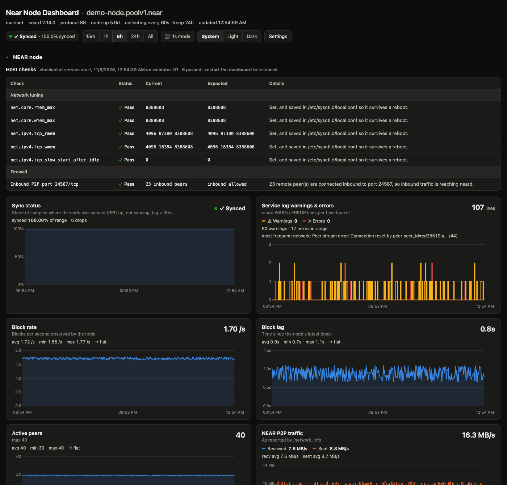
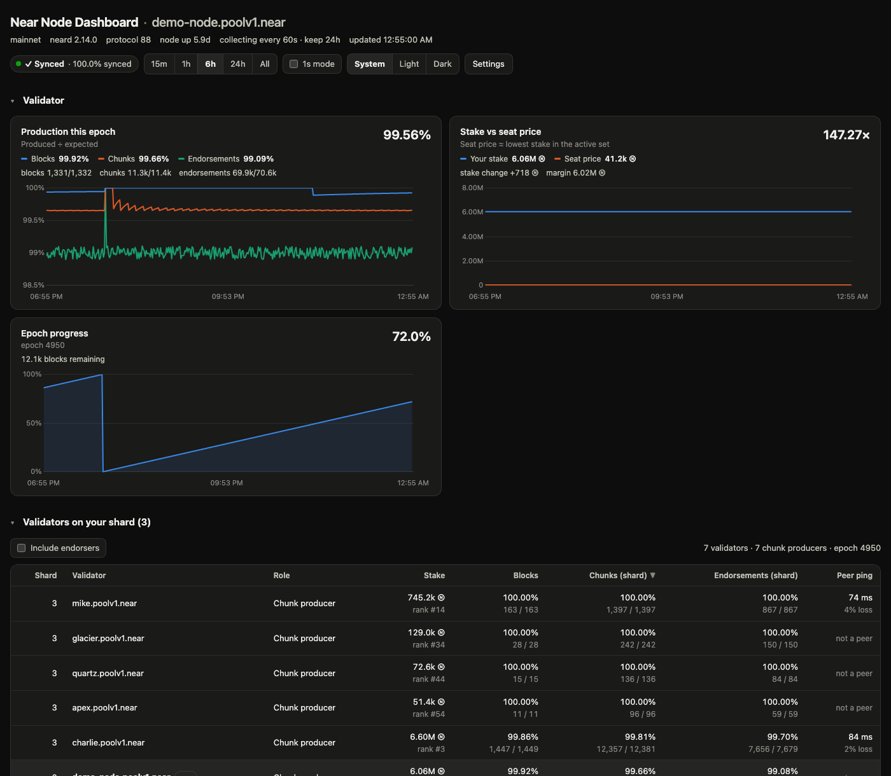
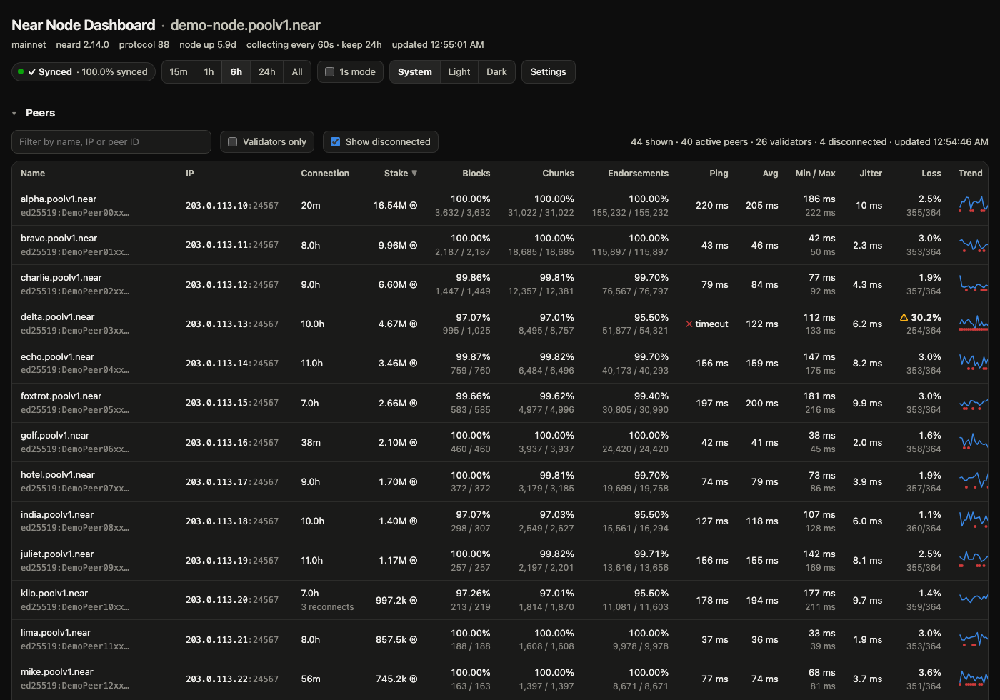
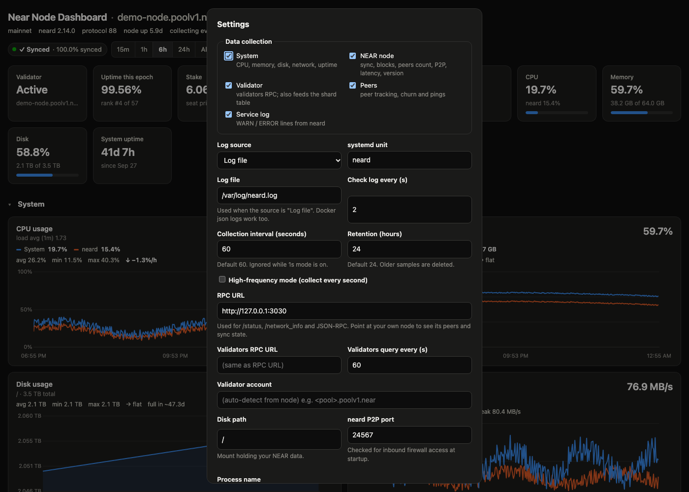

# Near Node Dashboard

A local dashboard for the server that runs your NEAR validator (`neard`). It records system and NEAR node metrics in SQLite and shows each one as a chart with its current value, average, min, max and per-hour trend.



## Install (on the validator host)

Requirements: Linux with systemd, git and Python 3.9+ (Ubuntu 22.04+ and Debian 11+ have Python and systemd). Replace `USER` with your login on the server and `NODE` with its address.

**1. Get the code** (on the server):

```bash
sudo apt install -y git        # if git isn't installed yet
git clone https://github.com/Nobody-Inc/NearNodeDashboard.git ~/near-node-dashboard
```

**2. Run the installer:**

```bash
cd ~/near-node-dashboard
sudo ./install.sh --dry-run    # optional: shows exactly what it will do
sudo ./install.sh
```

The installer:
- creates a system user `nearnode` with no login shell, and adds it to the `systemd-journal` group so it can read neard's log (and nothing broader);
- copies the dashboard to `/opt/NearNodeDashboard` and installs its Python dependencies in a private virtualenv. The code is owned by root and read-only for the service; `nearnode` can only write to `/opt/NearNodeDashboard/data` (database and settings);
- finds neard's systemd service and sets it as both the log source and a startup dependency;
- installs, enables and starts the `near-node-dashboard` service, listening on port 8787 on all of the server's IPv4 addresses, then checks that it answers.

**3. Open it** in a browser at `http://NODE:8787` (the installer prints the exact addresses). Then **restrict who can reach it**: see *Access and security* below.

**Options:** `--user NAME`, `--dir PATH`, `--port N`, `--neard-unit NAME` (if neard's service isn't detected) and `--listen ADDR` (`0.0.0.0` all IPv4, the default; `::` IPv4 and IPv6; `127.0.0.1` this server only).

**Upgrade:** pull the latest code and run the installer again. Your settings (`config.json`) and data are kept.

```bash
cd ~/near-node-dashboard
git pull
sudo ./install.sh
```

**Uninstall:** `sudo ./install.sh --uninstall` removes the service. Add `--purge` to also delete `/opt/NearNodeDashboard` (settings and data) and the `nearnode` user.

**Notes**
- The default settings expect neard's RPC at `http://127.0.0.1:3030`. Change it in **Settings** if yours differs.
- The `nearnode` user has no sudo rights, and the dashboard never tries sudo unless you turn on `firewall_check_sudo`. So the firewall check relies on seeing inbound peer connections, which works without root.
- Settings are saved in `/opt/NearNodeDashboard/data/config.json`. Older installs kept them in `/opt/NearNodeDashboard/config.json`; the installer moves them automatically.
- If neard logs to a file under `/var/log` that's only readable by the `adm` group, add the service user to it yourself (`sudo usermod -aG adm nearnode`). The installer doesn't, because `adm` can read every system log, auth logs included.
- Clone the repository somewhere other than `/opt/NearNodeDashboard` (e.g. `~/near-node-dashboard`). The installer replaces everything in the install folder except `data/` on each run.
- Service logs: `journalctl -u near-node-dashboard -f`.

### Access and security

The dashboard has **no login**. Anyone who can reach its port can view it and change its settings, including the RPC URL and the log file it reads. So limit who can connect:

- **Allow only your IP** with the server's firewall. With ufw:
  ```bash
  sudo ufw allow from YOUR_IP to any port 8787 proto tcp
  ```
  Cloud servers also have a provider firewall (security group). Don't open 8787 to the whole internet there either.
- **Or keep it private:** reinstall with `sudo ./install.sh --listen 127.0.0.1` and reach it through an SSH tunnel: `ssh -L 8787:127.0.0.1:8787 USER@NODE`, then open <http://localhost:8787>.

Requests must address the server by IP, `localhost` or its own hostname. This blocks DNS-rebinding attacks. To use a DNS name, add `--allow-host your.name` to the service's `ExecStart` line.

**Lock the settings (optional).** To stop anyone changing settings from the page, add `"read_only": true` to
`/opt/NearNodeDashboard/data/config.json` and run `sudo systemctl restart near-node-dashboard`. The page still works
and shows its data; the Settings dialog becomes view-only and a warning explains how to unlock it.

### Central monitoring (optional exporter)

To feed several nodes into a central system, install the optional second service, the **exporter**:

```bash
sudo ./install.sh --with-exporter      # options: --exporter-port 9787 --exporter-listen 0.0.0.0
```

It reads the dashboard's local API on a schedule (every collection interval by default, min 15 s) and republishes one read-only snapshot on port 9787:

| Endpoint | What it is |
|---|---|
| `/metrics` | Prometheus text format: system, node, validator, peer, log and host-check metrics, all labelled with `node` and `chain` |
| `/api/v1/snapshot` | The same data as JSON |
| `/` | Status page with **last updated** and a live **time to next update** countdown |
| `/healthz` | `200` when the last read of the dashboard succeeded, `503` otherwise (no token needed) |

Every response except `/healthz` requires the access token the installer generates, sent as `Authorization: Bearer <token>`, or `?token=<token>` in a browser. The installer prints the token at the end; to show it again, run `sudo cat /opt/NearNodeDashboard/data/exporter.token`. Allow only your central server through the firewall, e.g. `sudo ufw allow from CENTRAL_IP to any port 9787 proto tcp`.

Example Prometheus job:

```yaml
- job_name: near-node
  scrape_interval: 60s
  authorization:
    credentials: "<token>"
  static_configs:
    - targets: ["NODE:9787"]
```

`near_node_exporter_last_update_timestamp_seconds` and `near_node_exporter_next_update_timestamp_seconds` show how fresh the data is, so you can alert on stale data. Per-peer ping series are off by default (one series per peer); add `--per-peer` to the exporter's `ExecStart` line to enable them. Re-running the installer keeps the exporter; `--without-exporter` removes it.

### Which version is installed

The page footer shows the dashboard version and the git commit it was installed from, e.g. `v1.0.0 · 7d3d68e (2026-11-08)`. The commit links to GitHub, so you can compare it with the latest commit there. The exporter publishes the same as `near_node_dashboard_info`.

### Running it on your own computer instead

```bash
git clone https://github.com/Nobody-Inc/NearNodeDashboard.git
cd NearNodeDashboard
python3 -m venv .venv
.venv/bin/pip install -r requirements.txt
.venv/bin/python server.py            # http://127.0.0.1:8787 (add --host 127.0.0.1 to keep it local)
```

Settings are stored in `config.json` (created on first run). You can change them from the **Settings** button on the page or by editing the file. Changes made on the page apply right away; edits to the file take effect after a restart.

## Screenshots

*The screenshots use demo data: made-up pool names and documentation-only IP addresses.*

**NEAR node:** startup host checks, sync status, service log warnings and errors, block rate, lag, peers and P2P traffic.



**Validator:** block, chunk and endorsement production, stake vs seat price, epoch progress, and the other validators on your shard.



**Peers:** each peer's validator stats, connection time, ping, jitter, packet loss and a trend line.



**Settings:** what to collect, how often, the RPC endpoint, the log source and more.



## What it collects

| Group | Metrics |
|---|---|
| System | CPU % (whole machine and the `neard` process), load average, memory used and `neard` RSS, swap, disk usage on `disk_path` (with an estimate of when the disk will be full), disk read/write throughput, host network in/out |
| NEAR node (`/status`, `/network_info`) | block height, blocks/sec, block lag (time since the node's latest block), sync state, active peers, P2P traffic, RPC latency, version and protocol |
| Validator (`validators` JSON-RPC) | status (active, joining, proposal pending, not in set, kicked out with reason), stake, rank, seat price, blocks/chunks/endorsements produced vs expected this epoch, epoch progress and blocks remaining |

## Configuration (`config.json`)

| Key | Default | Meaning |
|---|---|---|
| `interval_seconds` | `60` | How often samples are collected |
| `fast_mode` | `false` | Collect every second, overriding `interval_seconds` (the **1s mode** toggle) |
| `retention_hours` | `24` | Samples older than this are deleted |
| `rpc_url` | `http://127.0.0.1:3030` | Endpoint for `/status`, `/network_info` and JSON-RPC. Use your own node to see its peers and sync state; a public NEAR RPC endpoint also works |
| `validators_rpc_url` | *(blank = `rpc_url`)* | A separate endpoint for the large `validators` call |
| `validators_interval_seconds` | `120` | How often `validators` is queried (~400 KB on mainnet). It runs in the background, so a slow call doesn't hold up 1s sampling |
| `validator_account_id` | *(blank)* | The pool account to track (`<pool>.poolv1.near`). If blank, the server uses the `validator_account_id` that your node reports |
| `disk_path` | `/` | The mount whose usage is tracked. Set it to the mount that holds `~/.near` |
| `process_name` | `neard` | The process whose CPU and memory are tracked |
| `collect_system` / `collect_node` / `collect_validator` / `collect_peers` | `true` | Turn data collection on or off for each section (also under **Settings → Data collection**). When off, that section's sampling stops, along with any RPC calls only it needs. Existing data is kept until retention deletes it. `collect_validator` also feeds the shard table; `collect_peers` covers peer tracking, churn and pings |
| `collect_logs` | `true` | Collect WARN / ERROR lines from the neard service log |
| `log_source` | `journald` | `journald` reads `journalctl -u <log_unit>`; `file` follows `log_file` (plain neard output or Docker json-file logs), and handles log rotation |
| `log_unit` / `log_file` | `neard` / *(blank)* | The systemd unit or the log file path |
| `log_poll_seconds` | `10` | How often to check the log for new lines |
| `p2p_port` | `24567` | neard's P2P port (`network.addr` in `~/.near/config.json`), checked for inbound access at startup |
| `firewall_check_sudo` | `false` | Read firewall rules with `sudo -n` when not root. Only enable it if the service user has passwordless sudo for `ufw`/`iptables`/`nft`/`firewall-cmd`; otherwise each attempt is logged as a failed sudo authentication |
| `read_only` | `false` | Lock the settings: when `true`, nothing can be changed from the web page (the Settings dialog becomes view-only and 1s mode is locked), and the page shows a warning. It can only be set by editing `config.json` on the server, and takes effect when the dashboard restarts |
| `ping_enabled` | `true` | Ping every active peer once per round |
| `ping_method` | `icmp` | `icmp` uses the system `ping` command. `tcp` times a TCP connection to the peer's NEAR port (24567), which works when a peer blocks ICMP |
| `ping_interval_seconds` | `60` | Seconds between ping rounds. 1s mode doesn't change this |
| `ping_timeout_ms` | `2000` | How long to wait before counting a ping as lost |

Command-line options: `--host` (bind address, default `0.0.0.0`; `::` for IPv4+IPv6; `127.0.0.1` for local only), `--port`, `--config`, and `--allow-host NAME` (repeatable).

The server only answers requests addressed to `localhost`, this machine's hostname, or an IP address; this blocks DNS-rebinding attacks. If you reach the dashboard by another name, such as a DNS name, a reverse proxy or an SSH config alias, start it with `--allow-host that.name`; otherwise you'll get `403 Host not allowed`.

## Notes

- In 1s mode the server calls `/status` every second and `/network_info` every 10 seconds. Public RPCs will rate-limit that (HTTP 429), so use 1s mode against your own node.
- At 1s sampling, 24 hours is about 86k rows per table, which SQLite handles easily. The API averages samples into time buckets, so a chart never draws more than about 600 points.
- The seat price shown is the lowest stake in the current active set.
- `install.sh` sets the dashboard (and, with `--with-exporter`, the exporter) up as systemd services. `near-node-dashboard.service` is an example unit file if you'd rather do it by hand.
- Peers that disconnect stay in the table, dimmed and marked "left Xm ago", for the selected time range, along with their last ping stats. Join and leave events are recorded in `peer_events` and shown in the **Peer churn** chart.
- Public RPC URLs are usually load-balanced across several nodes, so each request may reach a different node. The page detects this (the node key in `/status` changes) and shows a warning, because the peers, churn, peer ping and sync stats would then mix data from several nodes. Point `rpc_url` at a single node for accurate peer data.
- **neard version & protocol**: the network protocol version and the newest protocol your binary supports are charted on every sample. Each change of version, build or protocol is logged in `version_history`, which is never pruned.
- **Validators on your shard** appears when the node is an active validator, either from `validator_account_id` or detected from `/status`. It lists the chunk producers assigned to your shard this epoch, with their chunk and endorsement figures for that shard, and their ping if they're one of your peers. **Include endorsers** adds every validator that endorses the shard, which on mainnet is nearly all of them.
- Click a section header to collapse or expand it. Collapsed sections are remembered per browser.
- **Service log** (NEAR node section): WARN, ERROR and panic lines from neard, as a chart per time bucket and a searchable table. **Group repeats** treats lines as the same message when they differ only by numbers, hashes or IPs. Reading the journal requires the stats server's user to be in the `systemd-journal` (or `adm`) group; the panel shows a warning when it can't read the journal.
- **Host checks** (top of the NEAR node section) run once each time the dashboard starts:
  - **Kernel network settings:** `net.core.rmem_max`/`wmem_max` (8388608), `net.ipv4.tcp_rmem`/`tcp_wmem` (`4096 87380|16384 8388608`) and `net.ipv4.tcp_slow_start_after_idle` (0). Each is checked live (from `/proc/sys`) and in the files applied at boot, following systemd-sysctl order: `/etc`, `/run` and `/usr/lib` `sysctl.d` directories in file-name order, with `/etc/sysctl.conf` as `99-sysctl.conf` when it's linked there. A value that would reset or be overridden on reboot is flagged. Larger buffer maximums also pass. Linux only.
  - **Inbound firewall on `p2p_port`:** passes if remote peers are connected *to* that port, which shows traffic gets through every firewall in the path. Otherwise it reads ufw, firewalld, nftables and iptables rules where it can (as root, or with `sudo -n` if `firewall_check_sudo` is on).
  - **Remote node:** if neard isn't running on the dashboard machine and `rpc_url` points at another host, the local results are shown but not counted. Instead it opens a TCP connection to the node's P2P port, which is a real test from outside. A connection over a private (LAN/VPC) address is a warning, because it doesn't prove internet access.
  - **At boot:** if neard should be on this machine but isn't up yet, the checks wait up to 2 minutes for it.
  - Restart the dashboard to run the checks again.
